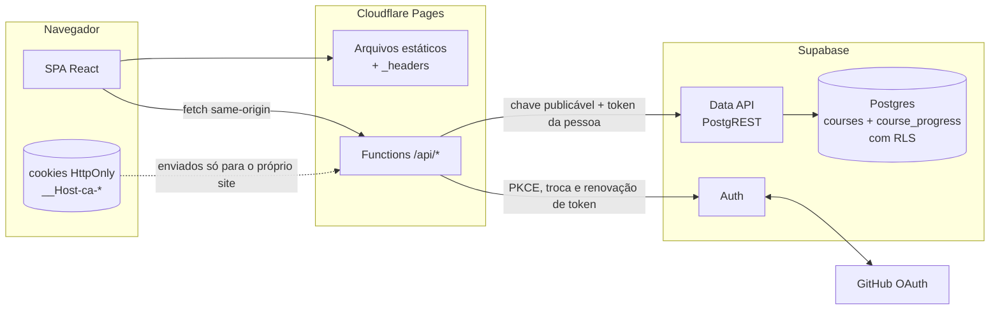
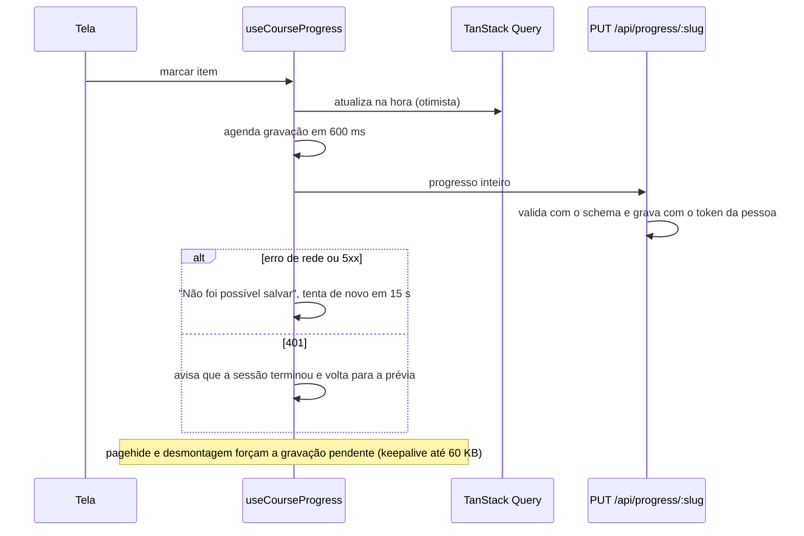

# Arquitetura

Este documento descreve o desenho da plataforma: requisitos, componentes, fluxo de dados, camadas e os pontos que devem ser revistos quando o projeto crescer.

## 1. Requisitos

### Funcionais

- Listar cursos e mostrar a página de cada um, mesmo para quem não entrou.
- Exigir login com GitHub para estudar.
- Gerar o plano diário a partir da data de início e do ritmo do curso.
- Marcar aulas, exercícios, projetos e dias como feitos; escrever anotações por módulo e diário por dia.
- Mostrar progresso, ritmo em relação ao plano e o que fazer hoje.
- Exportar e importar backup, exportar o diário e apagar o progresso.
- Publicar cursos novos sem mudar código.

### Não funcionais

| Requisito | Meta |
|---|---|
| Custo | Zero: plano gratuito do Cloudflare Pages e do Supabase |
| Segurança | Nenhuma chave nem token no navegador; sessão em cookies HttpOnly; dados de cada pessoa isolados por RLS |
| Privacidade | Mínimo de dados pessoais; nada no armazenamento do navegador; tudo exportável e apagável (LGPD) |
| Desempenho | Primeira tela útil rápida em celular; rotas carregadas sob demanda; catálogo em cache na borda |
| Manutenção | Uma pessoa mantém; código previsível, testado e documentado |

### Premissas

- Até alguns milhares de pessoas ativas: cabe com folga no plano gratuito do Supabase e no limite diário de invocações do Cloudflare.
- Cada pessoa estuda de um aparelho por vez na maior parte do tempo.
- Cursos mudam pouco e passam por revisão em pull request antes de serem importados.

## 2. Visão geral



- **O navegador fala só com o próprio site.** A CSP tem `connect-src 'self'`; não existe cliente Supabase no bundle, nem URL do projeto, nem chave.
- **As functions são um BFF** (backend for frontend): fazem o login, guardam a sessão em cookies e repassam as chamadas ao Supabase.
- **O RLS continua sendo a proteção dos dados.** As functions usam a chave publicável e o token da pessoa, nunca a chave secreta. Mesmo um bug nas functions não dá acesso ao progresso de outra pessoa.
- **O conteúdo dos cursos** fica na tabela `courses`, como um documento JSON por curso, e é validado pelo mesmo schema Zod no script de importação e no site.

## 3. Sessão e login

### Cookies

| Cookie | Conteúdo | Duração |
|---|---|---|
| `__Host-ca-access` | Token de acesso do Supabase (JWT) | Igual à validade do token, cerca de 1 hora |
| `__Host-ca-refresh` | Token de renovação | 30 dias |
| `__Host-ca-verifier` | Verificador PKCE do login em andamento | 10 minutos |
| `__Host-ca-return` | Caminho interno para voltar depois do login | 10 minutos |

Todos são `HttpOnly`, `Secure`, `SameSite=Lax` e `Path=/`, sem `Domain`. O prefixo `__Host-` faz o navegador recusar o cookie se alguma dessas condições faltar, e impede que um subdomínio defina cookies com esse nome.

### Fluxo de login

```mermaid
sequenceDiagram
  participant B as Navegador
  participant F as /api (Cloudflare)
  participant S as Supabase Auth
  participant G as GitHub
  B->>F: GET /api/auth/login?returnTo=/cursos/x
  F->>F: gera verificador PKCE e desafio S256
  F-->>B: 302 para S /authorize + cookies verifier e return
  B->>S: authorize (provider=github, redirect_to=/api/auth/callback)
  S->>G: OAuth
  G-->>S: código
  S-->>B: 302 para /api/auth/callback?code=...
  B->>F: GET /api/auth/callback (com cookie verifier)
  F->>S: POST /token?grant_type=pkce (código + verificador)
  S-->>F: access_token + refresh_token
  F-->>B: 302 para /cursos/x + cookies de sessão; apaga verifier e return
```

- O caminho de volta passa por `sanitize-return-path`: só caminhos internos simples são aceitos, o que impede redirecionamento aberto.
- Qualquer falha no callback leva a `/entrar?erro=login`, sem detalhes técnicos na URL.
- A cada requisição, `resolve-session` usa o token de acesso se ele ainda vale por mais de 60 segundos; senão, renova com o token de renovação e devolve cookies novos. Sem sessão válida, a resposta é 401 e os cookies são apagados.
- `POST /api/auth/logout` encerra a sessão no Supabase e apaga os cookies.

### Proteção contra CSRF

- `SameSite=Lax` impede que outro site envie os cookies em `POST`, `PUT` e `DELETE`.
- O middleware de `/api` recusa com 403 qualquer método que altera dados quando `Sec-Fetch-Site` não é `same-origin` ou, na falta dele, quando `Origin` não é o próprio site.
- Corpos de requisição só são aceitos como `application/json` e com tamanho limitado.

## 4. API

| Rota | Método | Sessão | O que faz |
|---|---|---|---|
| `/api/auth/login` | GET | não | Começa o login com GitHub |
| `/api/auth/callback` | GET | não | Termina o login e grava os cookies |
| `/api/auth/logout` | POST | opcional | Encerra a sessão |
| `/api/me` | GET | sim | Devolve `{ user: { id, displayName, avatarUrl } }` |
| `/api/courses` | GET | não | Cursos publicados, com cache público curto |
| `/api/courses/:slug` | GET | não | Um curso publicado |
| `/api/progress/:slug` | GET, PUT, DELETE | sim | Progresso da pessoa no curso |

Erros seguem o formato `{ "error": { "code": "...", "message": "..." } }`, sem stack trace nem mensagem do Supabase. Toda resposta da API tem `Cache-Control: no-store`, exceto as de cursos.

## 5. Camadas e módulos

### Site (`src/`)

Cada módulo segue Clean Architecture. As dependências apontam para dentro:

```
presentation  ->  application  ->  domain
infra         ->  application  ->  domain
main/factories monta tudo e é a única ponte entre presentation e infra
```

| Módulo | Responsabilidade | Exporta pelo `index.ts` |
|---|---|---|
| `courses` | Catálogo, prévia pública, plano de estudo, painel do curso | rotas |
| `progress` | Estado do progresso, salvamento, backup, diário | hook de progresso, barra de backup, status de salvamento |
| `auth` | Sessão, login, logout, página de entrar | provider, hook de sessão, menu do usuário, rotas |
| `legal` | Página de privacidade | rotas |
| `shared` | Cliente HTTP, erros de rede e de sessão, datas, texto, componentes genéricos | (importado por caminho) |
| `app` | Providers, router, layout | (ponto de entrada) |

O único acesso à rede é o `FetchHttpClient` (`shared/infra/http`): `credentials: 'same-origin'`, 401 vira `SessionExpiredError` e qualquer outra falha vira `HttpRequestError`. Os repositórios `HttpCourseRepository`, `HttpProgressRepository` e o `HttpAuthGateway` validam as respostas com Zod antes de entregar algo ao domínio.

### Servidor (`server/` e `functions/`)

- `functions/api/` segue o roteamento por arquivo do Cloudflare Pages. Cada arquivo só chama um handler.
- `server/modules/<auth|courses|progress>/` tem os handlers e as regras de cada assunto.
- `server/shared/` tem leitura da configuração, cookies, respostas HTTP, criptografia do PKCE e os clientes de Auth e REST do Supabase.
- `server/main/` monta os serviços por requisição e aplica o middleware (CSRF, cabeçalhos, tratamento de erro).

### Contratos (`contracts/`)

Schemas Zod usados pelos dois lados: conteúdo do curso, progresso, limites de tamanho e usuário autenticado. O servidor valida o progresso antes de gravar; o site valida o que recebe.

### Regras que o lint garante (`eslint.config.mjs`)

- `domain` não importa camadas externas nem bibliotecas (React, Zod, TanStack).
- `application` não importa `infra`, `main` nem `presentation`.
- `presentation` não importa `infra`.
- Um módulo só importa outro pelo `index.ts`.
- `src/` não importa `@supabase/*`, `server/` nem `functions/`, e não lê `import.meta.env`.
- `src/` não usa `localStorage`, `sessionStorage`, `indexedDB` nem `document.cookie`.
- `server/` e `functions/` não importam nada de `src/`.

### Onde está cada regra de negócio

| Regra | Arquivo |
|---|---|
| Distribuir aulas, exercícios e projeto pelos dias | `courses/domain/rules/plan/build-study-plan.rule.ts` e vizinhos |
| Horas por dia da semana | `courses/domain/rules/plan/hours-for-weekday.rule.ts` |
| Ritmo (à frente, atrás) | `courses/domain/rules/summary/calculate-pace.rule.ts` |
| Sequência e dias atrasados | `courses/domain/rules/summary/summarize-study-days.rule.ts` |
| Limites de texto e de entradas | `contracts/progress-limits.ts` |
| Renovação da sessão | `server/modules/auth/resolve-session.ts` |

Os parâmetros do plano (semanas por mês, parcela de projeto, parcela de estudo) ficam em `courses/domain/constants/plan-tuning.ts`.

## 6. Fluxos principais

### Abrir um curso

1. A rota `/cursos/:slug` carrega a página sob demanda.
2. `useCourseDetailsQuery` chama o caso de uso `GetCourseBySlug`, que busca `/api/courses/:slug` e valida o conteúdo.
3. Sem sessão, a página mostra a prévia (descrição, módulos e guia) com o botão **Entrar com GitHub para começar**.
4. Com sessão, `useCourseProgress` carrega `/api/progress/:slug` e `useCourseDashboard` monta o plano (memorizado pela data de início) e os view models da tela.

### Salvar



## 7. Modelo de dados

```sql
courses (
  slug        text primary key check '^[a-z0-9-]{1,60}$'
  content     jsonb  check objeto, slug igual ao da linha, até 1 MB
  published   boolean default false
  title       text gerado de content
  version     text gerado de content
  created_at, updated_at
)

course_progress (
  user_id     uuid  -> auth.users, on delete cascade
  course_slug text  -> courses.slug, on update cascade, on delete restrict
  data        jsonb check objeto, até 2 MB
  updated_at  timestamptz definido pelo servidor
  primary key (user_id, course_slug)
)
```

- `courses`: leitura dos publicados por qualquer um; escrita só com `app_metadata.role = 'admin'` no token. O script de importação usa a chave secreta e roda só na máquina de quem mantém a plataforma.
- `course_progress`: cada pessoa lê e grava só as próprias linhas.
- Guardar um documento por curso evita joins, simplifica o backup e cabe no padrão de acesso (sempre lido e gravado inteiro).

## 8. Escala e confiabilidade

| Tema | Situação atual | Limite conhecido |
|---|---|---|
| Leitura de conteúdo | `/api/courses` com `s-maxage=300` na borda | Atualização de curso leva alguns minutos para aparecer |
| Invocações das functions | Só `/api/*` passa pelas functions (`_routes.json`) | Plano gratuito: 100 mil requisições por dia |
| Escrita de progresso | Uma linha por pessoa por curso, gravação com debounce | Plano gratuito do Supabase: 500 MB de banco |
| Supabase pausado (7 dias sem uso no plano gratuito) | Login e progresso falham com mensagem clara | Projeto precisa ser reativado no painel |
| Conflito entre aparelhos | Última gravação vence | Edição simultânea em dois aparelhos perde a mais antiga |
| Atualização do site | Chunks novos com hash e cache imutável | Aba antiga pode falhar ao carregar rota; a tela de erro sugere recarregar |

## 9. Trade-offs principais

- **BFF com cookies** em vez de cliente Supabase no navegador: tokens fora do alcance de XSS e CSP fechada em `'self'`, ao custo de uma camada a mais para manter e de depender do Cloudflare.
- **Login obrigatório** em vez de modo visitante: nada de dados pessoais no navegador e um único caminho de código, ao custo de exigir conta do GitHub para estudar.
- **Conteúdo no Supabase** em vez de embutido no bundle: cursos publicados sem novo deploy, ao custo de uma requisição para abrir cada curso.
- **Supabase** em vez de banco próprio: Auth, RLS e backups prontos, ao custo de depender do plano gratuito.
- **Documento JSON por curso**: simples e rápido, sem consultas analíticas.
- **Última gravação vence**: simples e suficiente para uso individual.

## 10. O que revisar quando crescer

- **Uso em vários aparelhos ao mesmo tempo**: enviar o `updatedAt` lido e recusar gravação mais antiga (concorrência otimista), ou gravar alterações por item.
- **Limite de requisições**: um rate limit por IP ou por usuário nas functions (Cloudflare Rate Limiting) se aparecer abuso.
- **Tela de edição de cursos**: usar o papel `admin` que as políticas já preveem, em vez da chave secreta.
- **Mais provedores de login**: o provedor é escolhido num lugar só (`server/shared/supabase/supabase-auth-client.ts`); basta receber o provedor na rota de login, habilitar no Supabase e adicionar o botão.
- **Estatísticas para quem mantém os cursos**: criar uma view agregada sem dados pessoais, nunca abrir a tabela inteira.
- **Plano pago do Supabase** quando a pausa por inatividade ou o limite de 500 MB virarem problema.
