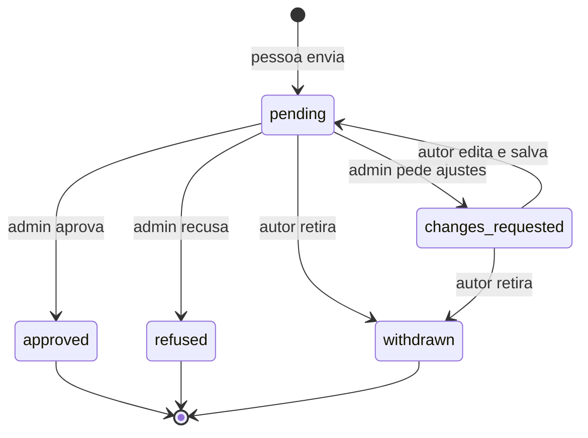

# Papéis e propostas de curso

Este guia explica quem pode fazer o quê na plataforma, como um curso novo entra pelo fluxo de propostas e o que fica registrado.

## Papéis

| Papel | Quem é | O que pode fazer |
|---|---|---|
| Estudante | Qualquer pessoa que entrou com o GitHub | Estudar, editar o próprio perfil e as preferências, propor cursos |
| Professor | Quem teve uma proposta aprovada (ou foi promovido por um admin) | Tudo do estudante, mais uma página pública e cursos próprios |
| Admin | Quem mantém a instância | Analisar propostas e versões, mudar papéis, tirar cursos do catálogo, transferir cursos, tratar avisos sobre perfis, encerrar sessões, bloquear e excluir contas, ver o histórico |

O papel fica na coluna `role` da tabela `profiles`. Ele só muda por funções do banco que conferem se quem pede é admin. A própria pessoa não consegue alterar o papel, nem pelo site nem chamando a API do Supabase direto: a permissão de escrita em `profiles` cobre só nome, texto, links e a opção de mostrar a contagem de estudantes.

O site esconde telas conforme o papel, mas isso é só conforto. Quem garante a regra é o banco: cada rota de admin chama uma função que recusa o pedido (erro 403) se a pessoa não for admin.

## O que cada papel vê

- **Perfil de estudante é privado.** Só a própria pessoa vê.
- **Perfil de professor é público** em `/professores/<endereco>`: nome, foto, texto, links e cursos publicados. A contagem de pessoas estudando só aparece se o professor marcar essa opção.
- **Notas, diário e progresso individual** ficam só com a pessoa. Professores e admins recebem apenas números somados (quantas pessoas estudam um curso, quantas estudaram nos últimos 30 dias). Um teste automático (`supabase/tests/functions/admin_rpcs.test.sql`) confere que nem um admin consegue ler o progresso de outra pessoa.
- **E-mail** nunca aparece em nenhuma tela, nem para admin.

## Fluxo de uma proposta

1. A pessoa abre **Propor curso** e preenche título, resumo, público, área, idioma e os títulos dos módulos previstos. Experiência, link de amostra e endereço sugerido são opcionais.
2. A proposta entra na fila do admin em **Admin > Propostas**.
3. O admin escolhe uma das três respostas:
   - **Aprovar**: informa o endereço do curso (o site sugere um a partir do título). Numa única transação, a pessoa vira professor, o curso é criado como rascunho com ela como dona e a proposta fica aprovada.
   - **Pedir ajustes**: escreve o que precisa mudar. A pessoa vê o recado, edita e salva; a proposta volta para a fila.
   - **Recusar**: escreve o motivo.
4. Enquanto está aberta (na fila ou com ajustes pedidos), a proposta pode ser editada ou retirada pelo autor. Depois de respondida, não muda mais.

Limites, aplicados pelo banco: no máximo 3 propostas abertas e 20 no total por pessoa.

## Cursos

- Um curso tem um dono (`courses.owner_id`) e pode estar **no catálogo** ou **fora do catálogo** (`courses.listed`).
- Fora do catálogo, o curso some da lista, mas continua abrindo pelo link para quem já estuda.
- Um curso com estudantes não pode ser apagado: o banco recusa. O caminho é tirar do catálogo.
- O admin transfere o curso pelo endereço do perfil, e só para quem já é professor ou admin. Tornar alguém professor é uma decisão separada, em **Pessoas e papéis**.
- Tirar do catálogo pede um motivo, que vai para o histórico, e aceita uma nota que fica no curso, visível só para a equipe.

## Contas

Em **Admin > Pessoas e papéis**, o botão **Conta** de cada pessoa tem três ações. Nenhuma mostra progresso, anotações ou diário.

| Ação | O que faz |
|---|---|
| Encerrar sessões | Apaga as sessões no Supabase: a pessoa precisa entrar de novo em todos os aparelhos |
| Bloquear | Bane o login no Supabase, encerra as sessões e impede qualquer gravação, mesmo com um token emitido antes (políticas restritivas com `private.is_blocked()`). O progresso fica guardado. Admin não pode ser bloqueado |
| Excluir | Apaga a conta e tudo ligado a ela. Recusado para quem tem curso (transfira antes) e para admins |

Ninguém muda o próprio papel nem usa essas ações na própria conta: outra pessoa admin precisa fazer.

## Avisos sobre perfis

Qualquer pessoa com login pode avisar a equipe sobre um perfil público (motivo e detalhes). Os avisos abertos aparecem em **Admin > Avisos** e na fila **Precisa de você**. O admin marca como resolvido ou arquiva; a pessoa avisada nunca vê quem avisou.

## Histórico

Cada ação da área de admin, cada proposta enviada e cada passo de uma versão geram uma linha em `audit_log`, com quem fez, quando, o tipo de ação e o alvo. A tabela não tem permissão de escrita nem de leitura pela API: só as funções do banco escrevem, e só a função `admin_list_audit` lê. O histórico guarda ids e valores antes e depois (por exemplo, o papel antigo e o novo), nunca textos escritos pelas pessoas.

## Primeira pessoa admin

Logo depois de aplicar as migrations não existe nenhum admin, então a primeira pessoa é marcada direto no banco. Veja o passo a passo em [configurando-contas.md](configurando-contas.md#8-primeira-pessoa-admin).

## Próximas etapas

| Etapa | O que entra |
|---|---|
| Tipos de exercício | Entrega com checklist, quiz, código com testes, passo a passo e reflexão |
| Laboratório | Ambientes no navegador, no GitHub Codespaces e no computador da pessoa, com verificação por etapas |
